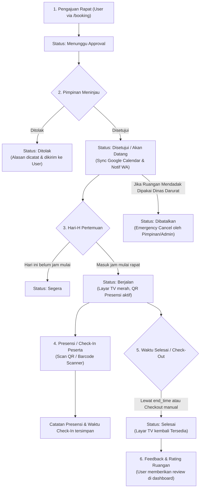

# 📘 DOKTRIN INDUK & PETUNJUK ARSITEKTUR SISTEM
## PROYEK: SISTEM INFORMASI DISPLAY & MANAJEMEN RUANG RAPAT
**Kementerian Ketenagakerjaan RI – Biro Keuangan dan BMN**

---

> ⚠️ **PETUNJUK UNTUK PENGEMBANG & AI ASSISTANT (CHATGPT, CLAUDE, CURSOR, COPILOT, DLL):**
> Dokumen ini adalah **Sumber Kebenaran Tunggal (*Single Source of Truth*)** arsitektur, basis data, alur bisnis, dan aturan koding untuk proyek ini.
> Setiap kali berinteraksi dengan AI coding assistant, **sertakan atau jadikan dokumen ini sebagai System Prompt / Doktrin Induk**, agar seluruh AI yang digunakan oleh setiap anggota tim menghasilkan kode yang konsisten, selaras, dan tidak saling merusak (*breaking changes*).

---

## 1. IDENTITAS & TUJUAN SISTEM

* **Nama Proyek:** Meeting Room Display & Management System
* **Instansi Pemilik:** Kementerian Ketenagakerjaan Republik Indonesia (Kemnaker RI) – Biro Keuangan dan BMN
* **Tujuan Utama:**
  1. **Display Publik Interaktif (`/` atau `/display`):** Ditampilkan pada TV/Smart Display di luar ruang rapat untuk menunjukkan jadwal rapat yang sedang berlangsung, countdown durasi, agenda berikutnya, jadwal sholat otomatis, running text pengumuman, dan QR Code presensi.
  2. **Portal Pengajuan Rapat (`/booking`):** Portal mandiri untuk pegawai/pemohon memesan ruang rapat, memilih fasilitas, mengunggah materi, dan menentukan peserta.
  3. **Dashboard Manajemen Terpadu (`/dashboard`):** Portal kelola untuk Admin dan Pimpinan guna menyetujui/menolak rapat, mengatur ruangan, mengelola pengguna (RBAC), memantau statistik, dan mengelola integrasi.
  4. **Presensi Cerdas (Check-in/Check-out):** Sistem presensi otomatis menggunakan pemindaian QR Code/Barcode Scanner di lokasi.
  5. **Integrasi Eksternal:** Sinkronisasi dua arah Google Calendar API v3 dan notifikasi persetujuan via WhatsApp Bot (SISKA).

---

## 2. ARSITEKTUR TEKNOLOGI

```
┌────────────────────────────────────────────────────────┐
│                   FRONTEND (React + Vite)              │
│  - Display TV Portal (/ & /display)                    │
│  - Booking Portal (/booking)                           │
│  - Login Page (/login)                                 │
│  - Admin/Pimpinan Dashboard (/dashboard)               │
│  - User Dashboard (/dashboard - role User)             │
│  - QR Scanner Check-in (/checkin/:id)                  │
└──────────────────────────┬─────────────────────────────┘
                           │ HTTP REST API (JSON)
┌──────────────────────────▼─────────────────────────────┐
│                 BACKEND (Node.js + Express)            │
│  - Express REST Routes (/api/dashboard/*)              │
│  - Dashboard Service (Core Business Logic)             │
│  - WhatsApp Notification Service (Bot SISKA)           │
│  - Prayer Time Service (Kemenag API / Fallback)        │
│  - Google Calendar Sync Service (OAuth/Service Account)│
│  - Auto-Seeder & Scrypt Password Security              │
└──────────────┬───────────────────────────┬─────────────┘
               │                           │
┌──────────────▼─────────────┐   ┌─────────▼─────────────┐
│  PRIMARY: PostgreSQL DB    │   │  FALLBACK / OFFLINE   │
│  (Pool connection, Tables: │   │  backend/data/        │
│  rooms, users, roles,      │   │  dashboard-store.json │
│  meetings, reviews, notif) │   └───────────────────────┘
└────────────────────────────┘
```

* **Frontend:** React 18, Vite, React Router DOM v6, Pure CSS / Modular Styling, Lucide Icons, HTML5-QRCode scanner. Default Port: `5173`.
* **Backend:** Node.js, Express.js, `pg` (node-postgres), `crypto` (`scrypt` password hashing), `googleapis`, `axios`. Default Port: `3001`.
* **Database Layer Dual-Mode:**
  * Mode Utama (*Online*): PostgreSQL lokal/cloud via `DATABASE_URL`.
  * Mode Fallback (*Offline*): File JSON lokal `backend/data/dashboard-store.json`.
  * Saat server backend dinyalakan, sistem otomatis menyinkronkan data database ke store memory.

---

## 3. AKTOR, HAK AKSES & AKUN MASTER (RBAC)

Sistem menggunakan kontrol akses berbasis peran (*Role-Based Access Control* / RBAC):

| Role | Username | Password Default | Akses & Wewenang |
| :--- | :--- | :--- | :--- |
| **Admin** | `admin` | `admin123` | Akses penuh: kelola rapat, ruangan, pengguna, konfigurasi WhatsApp/Google Calendar, check-in manual, laporan. |
| **Pimpinan (Approval 1)** | `approval1` | `approval123` | Menyetujui (*Approve*) atau menolak (*Reject*) permohonan rapat, pembatalan darurat (*Emergency Cancel*), tinjau jadwal. |
| **Wakil Pimpinan (Approval 2)**| `approval2` | `approval234` | Hak persetujuan setara pimpinan, backup approval. |
| **User (Pemohon)** | `andipratama` | `user123` | Mengajukan peminjaman ruangan (`/booking`), memantau status di dashboard user, check-in via QR, review ruangan. |
| **Custom Role** | *Dinamis* | *Dinamis* | Dibuat oleh Admin melalui menu Hak Akses dengan izin granular. |

### Aturan Permissions Granular:
* `manageMeeting`: Buat, edit, pindah, atau hapus rapat.
* `approve`: Setujui permohonan rapat.
* `checkInOut`: Lakukan check-in dan check-out sesi rapat.
* `emergencyCancel`: Batalkan rapat yang sudah disetujui dalam kondisi mendesak.
* `manageRoom`: Tambah, ubah data, fasilitas, atau hapus ruangan rapat.
* `manageUsers`: Buat akun baru, reset password, atur role pengguna.
* `manageSettings`: Konfigurasi running text, WhatsApp bot, Google Calendar.
* `viewReports`: Lihat statistik penggunaan, grafik utilisasi, dan cetak laporan.

---

## 4. LIFECYCLE RAPAT (WORKFLOW DARI PENGAJUAN HINGGA SELESAI)



### Rincian Status Rapat:
1. `Menunggu Approval`: Permohonan baru diajukan, menunggu tindakan pimpinan.
2. `Akan Datang`: Sudah disetujui, tanggal rapat berada di masa depan.
3. `Segera`: Sudah disetujui, rapat dijadwalkan **hari ini**, namun belum masuk jam mulai.
4. `Berjalan`: Waktu saat ini berada di antara `start_time` dan `end_time` rapat. Layar display TV luar ruangan menampilkan status "SEDANG DIGUNAKAN".
5. `Selesai`: Waktu rapat sudah lewat atau pemohon melakukan Check-Out.
6. `Dibatalkan`: Dibatalkan oleh Admin atau Pimpinan (Emergency Cancel).
7. `Ditolak`: Pengajuan ditolak oleh Pimpinan disertai alasan penolakan.

---

## 5. SKEMA BASIS DATA POSTGRESQL

### Tabel 1: `rooms` (Data Ruangan Rapat)
* `id` (SERIAL PRIMARY KEY)
* `name` (VARCHAR 150 UNIQUE NOT NULL) – Nama ruangan (cth: "Ruang Rapat Besar")
* `location` (VARCHAR 200 NOT NULL) – Lokasi (cth: "Gedung Pusat Kemnaker, Lt. 3")
* `capacity` (INT NOT NULL DEFAULT 10) – Kapasitas orang
* `status` (VARCHAR 50 DEFAULT 'Tersedia') – 'Tersedia' / 'Sedang Digunakan' / 'Pemeliharaan'
* `category` (VARCHAR 100)
* `description` (TEXT)
* `img` (TEXT) – URL/Path foto utama
* `images` (JSONB DEFAULT '[]') – Daftar foto galeri
* `facilities` (JSONB DEFAULT '[]') – Array of `{ label, value }` (cth: AC, TV, Mic)
* `created_at`, `updated_at` (TIMESTAMPTZ)

### Tabel 2: `users` (Pengguna & Akun)
* `id` (VARCHAR 100 PRIMARY KEY)
* `name` (VARCHAR 150 NOT NULL)
* `username` (VARCHAR 100 UNIQUE NOT NULL)
* `email` (VARCHAR 150)
* `dept` (VARCHAR 150 NOT NULL) – Bagian / Unit Kerja (cth: "Biro Keuangan dan BMN")
* `role` (VARCHAR 50 NOT NULL DEFAULT 'User') – 'Admin', 'Pimpinan', 'User', atau custom
* `status` (VARCHAR 50 DEFAULT 'Aktif') – 'Aktif' / 'Nonaktif'
* `password_hash` (TEXT) – Format hash scrypt: `salt:derivedKeyHex`
* `created_at`, `updated_at` (TIMESTAMPTZ)

### Tabel 3: `roles` (Definisi Peran & Izin)
* `name` (VARCHAR 80 PRIMARY KEY)
* `description` (TEXT)
* `permissions` (JSONB NOT NULL DEFAULT '[]') – Array kode izin
* `is_system` (BOOLEAN DEFAULT FALSE) – TRUE untuk Admin, Pimpinan, User bawaan
* `created_at`, `updated_at` (TIMESTAMPTZ)

### Tabel 4: `meetings` (Agenda & Peminjaman Ruangan)
* `id` (VARCHAR 100 PRIMARY KEY)
* `google_id` (VARCHAR 150) – ID Event Google Calendar
* `title` (VARCHAR 255 NOT NULL) – Judul rapat
* `agenda` (TEXT) – Agenda / Topik pembahasan
* `description` (TEXT)
* `requester` (VARCHAR 150 NOT NULL) – Nama pemohon / bagian
* `booked_by_id`, `booked_by_name`, `booked_by_username` (VARCHAR)
* `room_id` (INT REFERENCES rooms(id))
* `room_name` (VARCHAR 150)
* `date` (VARCHAR 20 NOT NULL) – Format: `YYYY-MM-DD`
* `start_time` (VARCHAR 10 NOT NULL) – Format: `HH:MM`
* `end_time` (VARCHAR 10 NOT NULL) – Format: `HH:MM`
* `status` (VARCHAR 50 NOT NULL DEFAULT 'Menunggu Approval')
* `participants` (INT DEFAULT 0)
* `approved_by` (VARCHAR 150)
* `rejection_reason` (TEXT)
* `checked_in_at` (TIMESTAMPTZ), `checked_in_by` (VARCHAR 150)
* `check_in_method` (VARCHAR 50) – 'barcode_qr', 'manual', dsb.
* `check_in_method_label` (VARCHAR 100)
* `checked_out_at` (TIMESTAMPTZ), `checked_out_by` (VARCHAR 150)
* `attendees` (JSONB DEFAULT '[]') – Daftar peserta rapat
* `materials` (JSONB DEFAULT '[]') – Dokumen / file materi
* `created_at`, `updated_at` (TIMESTAMPTZ)

### Tabel 5: `reviews` (Rating & Ulasan Ruangan)
* `id` (VARCHAR 100 PRIMARY KEY), `meeting_id`, `room_name`, `user_name`
* `rating` (INT NOT NULL DEFAULT 5), `comment` (TEXT), `admin_reply` (TEXT)

### Tabel 6: `notifications` (Notifikasi Sistem)
* `id` (VARCHAR 100 PRIMARY KEY), `meeting_id`, `type`, `title`, `message`, `status`, `read_by` (JSONB)

### Tabel 7: `meeting_audio_files` (Audio Rapat untuk Notulen Otomatis)
* `id` (VARCHAR 100 PRIMARY KEY), `meeting_id` (VARCHAR 100 NOT NULL)
* `kind` – 'rekaman' (direkam di browser, potongan berurutan) / 'unggahan'
* `original_name`, `file_name` (path relatif terhadap `NOTULEN_STORAGE_DIR`), `mime_type`
* `size_bytes` (BIGINT), `chunk_count` (INT) – nomor urut potongan berikutnya untuk rekaman
* `status` – 'merekam' / 'siap', `created_by`, `created_at`, `updated_at`

### Tabel 8: `meeting_minutes` (Transkrip & Notulen Otomatis, satu baris per rapat)
* `meeting_id` (VARCHAR 100 PRIMARY KEY)
* `status` – 'DRAFT' → 'PROCESSING' → 'DONE' / 'FAILED'
* `job_id`, `job_type` ('transcribe' / 'summarize'), `stage`, `stage_label`, `progress`, `stage_progress`, `eta_seconds`, `queue_position` – status job di service AI
* `error`, `minutes_error`, `warnings` (JSONB)
* `transcript` (JSONB) – Array of `{ start, end, speaker, text }`; `speakers` (JSONB) – `{ "SPEAKER_1": "Pak Budi" }`
* `minutes_md` (TEXT) – notulen Markdown; `minutes_reviewed` (BOOLEAN) – FALSE = draf AI yang wajib ditinjau notulis
* `minutes_edited_by`, `minutes_edited_at`, `whisper_model`, `llm_model`, `diarization`, `duration_seconds`, `started_by`, `started_at`, `finished_at`

### Tabel 9: `room_recorders` (Perekam Otomatis per Ruangan)
* `id` (VARCHAR 100 PRIMARY KEY), `room_name`, `label`
* `token_hash` / `pair_code_hash` – hanya hash SHA-256 (token perangkat & kode pemasangan sekali pakai), `pair_expires_at`, `paired_at`, `revoked_at`
* `last_seen_at`, `last_status` (JSONB: state, micLabel, error, pending), `created_by`, `created_at`, `updated_at`
* Kolom tambahan: `meeting_audio_files.recorder_id` (rekaman dari perangkat mana), `meeting_minutes.auto_processed_at` (sudah diproses otomatis)

> Audio rapat bersifat **rahasia** dan diproses 100% lokal oleh `ai-service/` (Whisper + Ollama). Fitur ini khusus Admin dan butuh PostgreSQL. Rincian: `docs/NOTULEN_OTOMATIS.md`.

---

## 6. HUKUM MUTLAK & ATURAN PENGEMBANGAN (COMMANDMENTS)

Seluruh anggota tim dan AI assistant **WAJIB** mematuhi aturan ini tanpa pengecualian:

1. **LARANGAN KERAS: Tidak Boleh Mengembalikan `dummyDB` di Frontend!**
   * Autentikasi harus selalu memanggil endpoint backend: `POST /api/dashboard/login`.
   * Password di backend diamankan menggunakan hashing `crypto.scryptSync`. Jangan pernah menyimpan atau membandingkan password dalam bentuk plaintext.
2. **PRESERVASI AUTO-SEEDER:**
   * Fungsi `seedDefaultData()` di `backend/src/services/dashboard.service.js` **TIDAK BOLEH DIHAPUS**.
   * Fungsi ini menjamin saat developer lain melakukan `git pull` dan menjalankan server, database mereka langsung memiliki akun master (`admin`, `approval1`, `approval2`, `andipratama`).
3. **KONFLIK JADWAL RUANGAN:**
   * Setiap booking baru wajib divalidasi bentroknya: Tidak boleh ada 2 rapat yang berstatus aktif di ruangan yang sama, tanggal yang sama, dengan rentang jam (`start_time` - `end_time`) yang bersinggungan.
4. **INTEGRITAS FILE JSON STORE:**
   * File `backend/data/dashboard-store.json` masuk ke dalam `.gitignore`. Jangan pernah memaksa menambahkan file ini ke Git (`git add -f`). Gunakan `dashboard-store.example.json` untuk template.
5. **ATURAN BRANCHING & GIT:**
   * Setiap anggota tim mengerjakan tugasnya di branch masing-masing (misal: `feature/fadil`, `feature/windy`).
   * Sinkronisasi dari `main` dilakukan dengan:
     ```bash
     git pull origin main
     ```
   * DILARANG melakukan `git push --force` ke branch `main`.
6. **PRESERVASI KOMENTAR & KODE:**
   * Pertahankan komentar dan fungsi yang tidak berkaitan langsung dengan task Anda. Jangan melakukan refactor besar-besaran di luar instruksi task.

---

## 7. CARA MENGGUNAKAN DOKTRIN INI PADA AI TOOLS

Bagi setiap anggota tim yang berkolaborasi menggunakan AI (Cursor AI, ChatGPT, Claude, Copilot, Antigravity):

### Untuk Cursor / VS Code / Claude Dev:
* Letakkan dokumen ini di root proyek dengan nama **`PROJECT_DOCTRINE.md`**.
* Tambahkan file ini ke **Cursor Rules (`.cursorrules`)** atau masukkan sebagai context saat prompt AI: `@PROJECT_DOCTRINE.md`.

### Untuk ChatGPT / Claude Web:
* Salin teks dokumen ini, lalu tempel di awal percakapan Anda dengan kalimat pembuka:
  > *"Berikut adalah DOKTRIN INDUK proyek 'Meeting Room Display'. Harap pelajari arsitektur, skema tabel, akun master, dan aturan pengembangannya. Semua solusi dan kode yang kamu hasilkan harus 100% patuh pada doktrin ini."*

